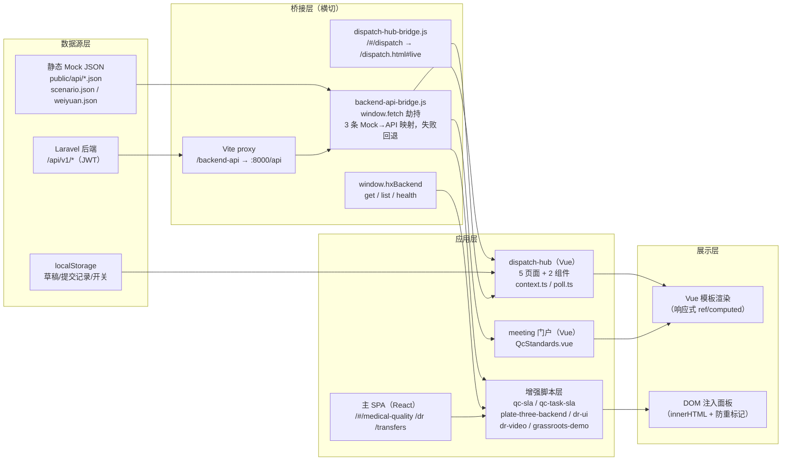
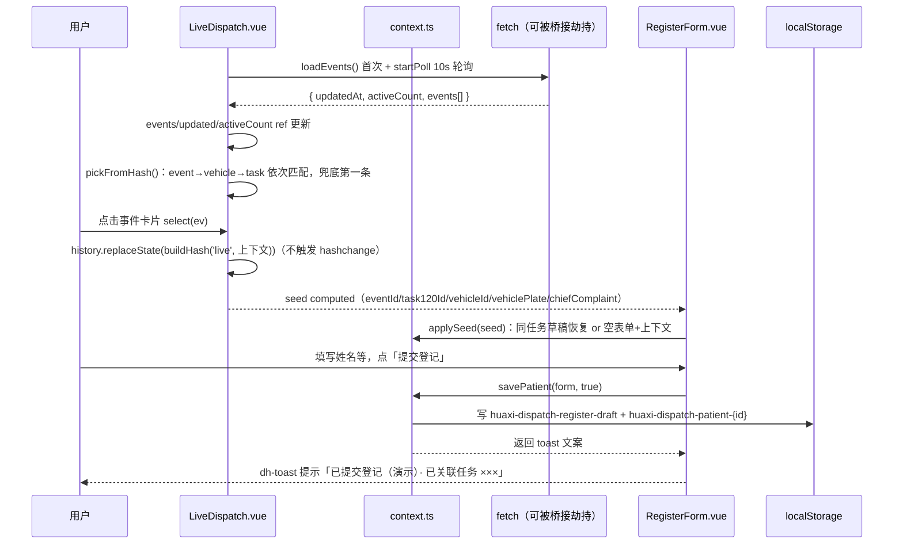
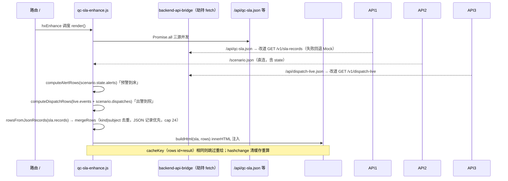
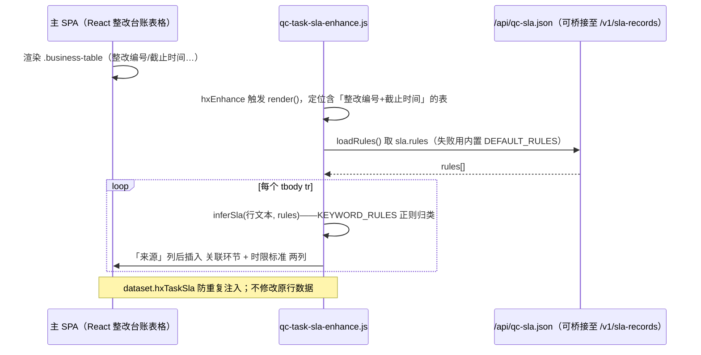

# 三大模块前端数据流转文档（基层调度 · 医院质控 · 基层医生Dr）

> 版本：V1.0 ｜ 编制日期：2026-10-13
> 分析对象：`huaxi-command-center`（与 `后端接口文档/09-三大模块(基层调度、医院质控、基层医生Dr)专项/` 接口文档配套）
> 编制方式：基于仓库内源码逐文件梳理（Vue SFC / 原生增强脚本 / 桥接脚本 / Vite 配置 / Laravel 路由），所有函数名、字段名、存储键均直接取自代码；推断与待确认项集中在 §8，不与事实混写。
> 阅读对象：前端开发、后端联调、测试、新人上手、技术负责人。

---

## 1. 概述

本文档描述三大模块在前端的完整数据流转闭环：**数据从哪里来（Mock JSON / localStorage / Laravel 后端）→ 经过什么处理（轮询、合并计算、格式化、劫持代理）→ 存在哪里（组件 ref、localStorage）→ 如何展示（模板渲染、DOM 注入）→ 用户操作后如何回传（表单提交、hash 跳转、链路衔接）**。

覆盖范围：

| 模块 | 页面/入口 | 实现形态 |
| --- | --- | --- |
| 基层调度 | `dispatch.html`（Vue 子应用，5 个 Tab 页） | **真实组件实现** |
| 基层调度 | 主站 `/#/dispatch` → 子应用重定向 | 桥接脚本 |
| 医院质控 | 会诊门户 `QcStandards.vue`（质控标准页） | **真实组件实现** |
| 医院质控 | 主站 `/#/medical-quality`、`/#/medical-quality/reports` | 主 SPA 占位 + 3 个增强脚本注入 |
| 基层医生Dr | 主站 `/#/dr`（`.dr-page`） | 主 SPA 渲染 + 3 个增强脚本注入 |
| 转诊演示链 | `/#/consultations`、`/#/transfers` 顶栏 | 增强脚本注入 |

一个贯穿全文的关键机制：**`backend-api-bridge.js` 对 `window.fetch` 做了全局劫持**，把三个静态 Mock 路径代理到 Laravel `/api/v1`，失败自动回退 Mock——所有走 `fetch('/api/qc-sla.json')`、`fetch('/api/dispatch-live.json')` 的组件代码不需要任何改动即可在后端可用时切换数据源（详见 §5.4）。

---

## 2. 技术栈说明

| 层 | 技术 | 说明 |
| --- | --- | --- |
| 基层调度子应用 | Vue 3 `<script setup>` + TypeScript + Vite | `src/dispatch-hub/`，hash 路由（`#/live` 等），无路由库，自实现 |
| 会诊门户子应用 | Vue 3 `<script setup>` | `src/meeting/`，质控标准页所在 |
| 主 SPA | React（构建产物 `public/assets/index-BA_IO3dC.js`） | hash 路由 `/#/...`；`/dr`、`/medical-quality` 等页面的 DOM 由构建产物渲染，源码快照见 `reference/original-index.js` |
| 增强脚本层 | 原生 JS IIFE + `window.hxEnhance` 调度器 | `public/assets/*enhance*.js`，负责 DOM 注入与数据拉取，不依赖框架 |
| 图表 | ECharts 5 | 车辆监控地图（`registerMap('weiyuan')`） |
| 数据源 | 静态 JSON（`public/api/*.json`、`public/scenario.json`、`public/maps/weiyuan.json`） | 演示数据，`cache: 'no-store'` 拉取 |
| 后端桥接 | `backend-api-bridge.js`（fetch 劫持）+ `window.hxBackend` + Vite proxy | 开发环境 `/backend-api` → `http://127.0.0.1:8000/api`（`vite.config.ts:26-31`） |
| 本地持久化 | localStorage | 草稿、提交记录、功能开关（键清单见 §6.4） |
| 后端 | Laravel 10（JWT：tymon/jwt-auth） | 业务路由统一 `auth:api` 中间件，仅 `/health` 与 `/auth/login` 免鉴权 |

**共享基础设施**（所有增强脚本的运行前提）：

- `boot-recover.js` 定义 `window.hxEnhance(fn, opts)`：debounce（默认 320ms）+ `hashchange` 后延迟执行（`afterNav`）+ 可选 `#root` MutationObserver 监听，防止 SPA 重渲染后增强丢失。各增强脚本的 `render()` 都经它调度。
- `index.html` 加载顺序：`boot-recover.js` → `backend-api-bridge.js` → React bundle → 各 `defer` 增强脚本（保证桥接在业务 fetch 发生前就位）。

---

## 3. 总体数据流架构

三条并行的数据通道：

1. **组件内 fetch**（Vue 页面）：`context.ts loadEvents()`、`QcStandards.vue` 等，写法上是 fetch Mock 路径，运行时可能被桥接改道到后端。
2. **增强脚本 fetch / hxBackend**：增强脚本自行拉数据（`qc-sla-enhance` 三源合并、`plate-three-backend-enhance` 走 `hxBackend.list/get`），然后 `innerHTML` 注入面板。
3. **localStorage 通道**：`RegisterForm` 的草稿与提交记录，纯前端闭环（当前未回传后端，见 §8 待确认）。

---

## 4. 页面与组件总览

| 页面/脚本 | 文件 | 数据输入 | 数据输出/去向 |
| --- | --- | --- | --- |
| 实时出警 | `dispatch-hub/pages/LiveDispatch.vue` | `loadEvents()` 10s 轮询；hash 上下文 | 选中事件 → `VehicleDesk` props + `RegisterForm` seed；hash 回写 |
| 急救事件 | `dispatch-hub/pages/EventsList.vue` | `loadEvents()` 一次性 | 跳转链接（`#live?...` / `#register?...`） |
| 救护车列表 | `dispatch-hub/pages/AmbulanceList.vue` | `dispatch-ambulances.json` + `loadEvents()`（`Promise.all`） | 行选中 → `VehicleDesk`；跳转链接 |
| 车辆监控 | `dispatch-hub/pages/VehicleMonitor.vue` | `vehicles-gps.json` 5s 轮询；`weiyuan.json` 地图 | ECharts 散点动画；ETA 侧栏；会诊链接 |
| 患者登记 | `dispatch-hub/pages/PatientRegister.vue` | hash 上下文 + `loadEvents()` 匹配补全 | seed → `RegisterForm` |
| 登记表单 | `dispatch-hub/components/RegisterForm.vue` | props.seed + localStorage 草稿 | `savePatient()` → localStorage；toast；会诊链接 |
| 车辆工作台 | `dispatch-hub/components/VehicleDesk.vue` | 全 props（纯展示） | 内嵌 `VehicleMonitor`（embedded）；会诊链接 |
| 公共层 | `dispatch-hub/context.ts`、`poll.ts` | — | 类型、hash 工具、草稿存取、`loadEvents`、`startPoll` |
| 质控标准 | `meeting/pages/QcStandards.vue` | `qc-standards.json` 一次性 | 模板渲染（版本号/标准列表/近期抽检） |
| 环节时限 | `public/assets/qc-sla-enhance.js` | `qc-sla.json` + `scenario.json` + `dispatch-live.json` **三源** | `/#/medical-quality` 注入 `#hx-sla-dock` 表格 |
| 质控提醒列 | `public/assets/qc-task-sla-enhance.js` | 整改表格 DOM + `qc-sla.json` rules | 表格插入「关联环节/时限标准」两列 |
| 质控统计 | `public/assets/plate-three-backend-enhance.js` | `hxBackend.get('/qc-issues-report')` | `/#/medical-quality/reports` 注入 KPI + 机构表 + CSV 导出链接 |
| Dr 页增强 | `public/assets/dr-ui-enhance.js` / `dr-video-enhance.js` | `.dr-page` DOM；`/media/{id}.mp4` 路径 | 连续播放开关移位；B 站 iframe 替换 |
| Dr 后端面板 | `plate-three-backend-enhance.js` `renderDr()` | `hxBackend.list('/doctors'、'/clinical-records')` | `/#/dr` 注入医生/诊疗记录双列面板 |
| 转诊演示链 | `public/assets/grassroots-demo-enhance.js` | `grassroots-demo.json` | `/#/consultations`、`/#/transfers` 顶栏步骤条 + 行高亮 |
| 后端桥接 | `public/assets/backend-api-bridge.js` | 3 条 Mock 路径的请求 | 代理到 `/backend-api/v1/*`，失败回退 Mock |

---

## 5. 核心流转链路详解

### 5.1 基层调度 · dispatch-hub（Vue 子应用）

#### 5.1.0 公共层

- **`context.ts`** 是该子应用唯一的数据访问与工具层：
  - `loadEvents()`：`fetch('/api/dispatch-live.json', { cache: 'no-store' })` → `{ updatedAt, activeCount, events }`。这是全子应用共享的事件数据入口（经桥接可切后端 `GET /v1/dispatch-live`）。
  - `startPoll(fetcher, onData, ms)`（`poll.ts`）：立即执行一次 + `setInterval` 循环，异常静默吞掉，返回 `stop()` 清理函数。**所有轮询统一走它**。
  - hash 工具组：`tabFromHash()`（Tab 解析，`monitor` 特判）、`hashQuery()/contextFromHash()`（从 hash query 取 `event/task/vehicle/plate/complaint` 五个上下文键）、`buildHash(tab, ctx)`（反向生成）。
  - 草稿组：`loadDraft()` / `savePatient(form, submit)`，键 `huaxi-dispatch-register-draft`（见 §5.1.5）。
  - 展示工具：`formatClock()`（ISO → `MM-DD HH:mm`）、`statusTone(status)`（**按中文关键字着色**：含「出警/返院」→ run，「现场/处置」→ scene，「待命」→ idle，兜底 run）。
- **`App.vue` 路由分发**：`hashchange → sync() → tabFromHash()`；`#monitor` 重定向为 `#live`（query 原样保留）；`computed Current` 按 Tab 映射四个页面组件，`<component :is>` 动态挂载——**页面间不共享内存状态，每个页面独立拉数据，跨页上下文全部经 hash query 传递**。

#### 5.1.1 实时出警 LiveDispatch（最复杂链路）

要点：

- **轮询与选中解耦**：10s 轮询整体替换 `events`；`load()` 末尾若当前 `selectedId` 失效（事件消失）则 `pickFromHash()` 重选。`watch(events)` 兜底初次选中。
- **`select()` 用 `history.replaceState` 而非改 `location.hash`**：把选中上下文写进 URL 但**不触发** `hashchange`（避免 `pickFromHash` 抢占用户选择）。
- **统计口径**：`running`/`onScene` 是对 `status` 字符串做 `includes('出警')`、`includes('现场')||includes('处置')` 的中文匹配计算；`activeCount` 直接用后端返回值。
- **两级下传**：选中事件同时喂给右侧 `VehicleDesk`（10 个 props，含 `scorePlan/treatPlan`）和 `RegisterForm :seed`。

#### 5.1.2 急救事件 EventsList / 救护车列表 AmbulanceList

- **EventsList**：`onMounted` 一次性 `loadEvents()`，无轮询。每行两个跳转链接 `liveHref/registerHref` 都由 `buildHash` 携带完整上下文——数据跨页流转的**唯一媒介是 URL**。
- **AmbulanceList**：`Promise.all` 并发拉 `dispatch-ambulances.json`（车辆台账）与 `loadEvents()`（事件），**本地做关联**：`eventOf(row) = events.find(e => e.id === row.currentEventId)`。选中逻辑：优先 hash `?vehicle=`，否则第一行；行点击更新 `selectedId` → `computed selected/selectedEvent` → `VehicleDesk`（额外传 `hospital/crew`）。
- 车辆行状态徽标同样走 `statusTone` 中文匹配。

#### 5.1.3 车辆监控 VehicleMonitor（GPS 动画链路）

1. `onMounted`：先 `fetch('/maps/weiyuan.json')` → `echarts.registerMap('weiyuan')` → `echarts.init(root)`；再 `load()`。
2. `load()`：`fetch('/api/vehicles-gps.json', { cache:'no-store' })` → `vehicles` ref；`focusId`（来自 `VehicleDesk :focus-id="vehicleId"`）优先选中，否则第一条；**每次 load 后立即 `renderMap()`**。
3. 双周期驱动：
   - `startPoll(load, …, 5000)`：5s 刷新 GPS 数据。
   - `anim = setInterval(800ms)`：`t += 0.02`，`renderMap()` 里对每车按 `idx = floor(((t + i*0.2) % 1) × (route.length-1))` 在 `route` 折线上取点——**演示用插值动画，非真实实时坐标**。
4. 侧栏（非 embedded）：车辆切换按钮、`etaMinutes`、车内视频占位（`data-hx-video="vehicle"`）、`发起远程会诊` 链接（`/#/consultations?plate=&vehicle=`）。
5. `embedded` 模式（被 `VehicleDesk` 内嵌）：只渲染地图 + 视频占位，不渲染标题侧栏。
6. `onUnmounted`：停轮询、停动画、`chart.dispose()`。

#### 5.1.4 患者登记 PatientRegister（上下文补全链路）

`onMounted`：`contextFromHash()` 得 `seed`；若 hash 带了 `event/vehicle/task` 任一键，再 `loadEvents()` 按 **event → vehicle → task** 顺序匹配事件，用完整事件字段覆盖 `seed`（保证 `vehiclePlate/chiefComplaint` 等字段补齐）。右侧栏直接展示 `seed` 的任务号/车牌/主诉。

#### 5.1.5 登记表单 RegisterForm（本地持久化闭环）

- **seed 合并策略 `applySeed()`**（`watch` seed 键 `eventId|task120Id|vehicleId`，`immediate: true`）：
  - 草稿存在且 `draft.task120Id === seed.task120Id`（同一任务）→ 以草稿为底（姓名/性别/年龄/电话沿用草稿），上下文字段仍以 seed 优先——**换车不丢已填患者信息，换任务则清空个人信息**。
  - 非同任务：`emptyForm()` 为底（`gender: '男'`），仅覆盖 seed 提供的字段；个人信息取「无任务时保留草稿」逻辑（`seed.task120Id ? '' : draft?.name || ''`）。
- **提交 `submit()`**：校验 `name` 非空（失败 → warn toast）→ `savePatient(form, true)`。
- **`savePatient` 双写**：
  - 总是写 `huaxi-dispatch-register-draft`（最新表单快照，下次恢复用）；
  - `submit=true` 时另写 `huaxi-dispatch-patient-{task120Id||eventId||DRAFT-{时间戳}}`（含 `savedAt`）——即"已提交登记"存档。
  - 返回 toast 文案（含任务号关联提示）。
- **跨模块出口**：`consultHref(form)` → `/#/consultations?task=…&plate=…&vehicle=…&complaint=…`，把登记上下文带给会诊页（衔接主 SPA 会诊场景）。

#### 5.1.6 车辆工作台 VehicleDesk

纯 props 展示组件（无自身数据请求）：头部（车牌·状态 + `consultHref(props)` 会诊按钮）→ 元信息 dl → **内嵌 `<VehicleMonitor embedded :focus-id="vehicleId" />`**（该车辆的 GPS 地图）→ 评分/救治方案（`scorePlan/treatPlan`，缺省占位文案）。父级传入的 `null/undefined` 字段用 `v-if` 隐藏对应行。

---

### 5.2 医院质控

#### 5.2.1 质控标准页 QcStandards.vue（会诊门户）

最简链路：`onMounted → fetch('/api/qc-standards.json')` → 一次性写入 `version/standards/events` 三个 ref → 模板渲染（`complianceRate × 100` 取整显示百分比；抽检记录按 `e.ok` 着色「达标/未达标」）。经桥接该请求实际落到 `GET /v1/qc-standards/summary`。

#### 5.2.2 环节时限 qc-sla-enhance.js（三源合并计算，重点链路）

计算规则（全部在前端）：

- **预警到床**（阈值 `SLA-ALERT.limitMinutes`，缺省 10）：遍历 `scenario.state.alerts`，跳过 `resolved` 与 7 天前；到达时刻取 `records` 最后一条 `.at`，否则非 `new` 状态取 `updatedAt`；有到达 → `达标/超时`，无 → `待到达/超时` 并显示已用时。责任人回溯：`records` 最后 `actorId` → 患者 `assignedTo[0]` → 「当班医生」；对象为 `患者名 · 床位label`。
- **出警到院**（阈值 `SLA-DISPATCH.limitMinutes`，缺省 30）：先按 `dispatch-live.events` 算（状态匹配 `/到院|已完成|送达/` 时用 `startedAt + etaHospitalMinutes` 估到达；`scenario.dispatches` 的 `milestones[at-hospital].at` 优先）；再补 `scenario.dispatches` 中不在 live 里、已到院或进行中的记录。责任人固定「随车组」。
- 规则来源：`sla.rules`（经桥接来自后端），空则内置 `DEFAULT_RULES`；表头徽标统计超时条数。
- 数据行 `source` 字段标记来源（`scenario` / `dispatch-live` / `qc-sla.json`），便于区分演示与真实数据。

#### 5.2.3 质控提醒列 qc-task-sla-enhance.js（DOM 表格增强）

1. 仅 `/medical-quality` 页生效；在 `.quality-workspace` 里找**表头同时含「整改编号」和「截止时间」**的表格（即主 SPA 渲染的整改台账）。
2. `loadRules()`：`qc-sla.json` → `rules`（失败用 `DEFAULT_RULES`）。
3. `inferSla()`：把行文本按 `KEYWORD_RULES` 正则归类——`/预警|NEWS|危急值|体征…/` → 预警到床 ≤10 分钟；`/120|出车|出警|到院…/` → 出警到院 ≤30 分钟；`/绿色通道|胸痛|卒中…/` → 五大中心路径；`/闭环|销号|整改/` → 整改工单；都不中 → 「见整改截止时间」。规则 id 能对上 `sla.rules` 时用后端返回的名称与阈值。
4. 在「来源」列后插入「关联环节」「时限标准」两列（表头 + 每行单元格），`dataset.hxTaskSla` / `hx-task-sla-kind` class 防重复注入。
5. **数据流性质：纯 DOM 增强——不改动原表格数据，只读行文本做分类展示。**

#### 5.2.4 质控统计 plate-three-backend-enhance.js `renderQcReport()`

`/#/medical-quality/reports` 页：`backendOk()` 探活通过后 `hxBackend.get('/qc-issues-report')` → 渲染 KPI（`total` / `by_severity.HIGH` / `by_status.QC_OPEN`）+ `by_org` 前 8 行机构表（`supervise_target/total/closed/overdue/on_time_rate`）+ 底部 CSV 导出链接（`<a href="/backend-api/v1/qc-issues-export" download>`）。探活失败或请求异常 → 空态文案「无法加载 qc-issues-report」。

---

### 5.3 基层医生Dr

页面 DOM（`.dr-page`：播放列表 `.dr-playlist`、播放器 `.dr-player video`）由主 SPA 构建产物渲染；三个增强脚本在其上叠加数据与交互：

#### 5.3.1 dr-ui-enhance.js（布局增强）

- `enhanceContinuousPlayback()`：把「连续播放」`label.dr-continuous` 移入播放列表标题栏 `.dr-pl-head`（`data-dr-placed` 防重）。
- `markVideoView()`：hash 为 `/dr`（`view=videos` 或无 view）时在页首插入「视频展示」标签条。

#### 5.3.2 dr-video-enhance.js（视频源替换）

- 输入：`.dr-player video` 的 `src`，用正则 `/\/media\/([^.?#]+)\.mp4/i` 提取视频 id。
- `BILI_VIDEOS` 映射表：`cpr` / `earthquake` / `flu` 三个 id → B 站 `bvid` + 标题 + 主题。
- 命中 → `mount()`：隐藏原 `<video>`，插入 B 站 iframe（`player.bilibili.com/player.html?bvid=…&autoplay=0`），同步更新标题与主题；未命中但之前替换过 → `teardown()` 还原。`dataset.hxBiliVideoId` 防止重复挂载。
- 本地存在 `/media/*.mp4` 时 id 不在映射表 → 不干预，走本地视频。

#### 5.3.3 renderDr()（后端业务数据面板）

`/#/dr` 页：`hxBackend.list('/doctors', { per_page: 20 })` 与 `list('/clinical-records', { per_page: 15 })` 并发 → 双列面板（医生：`real_name/username · org.org_name · user_status`；诊疗记录：`record_code · diagnosis/chief_complaint · visit_at · doctor_name`）。空态分别提示「暂无医生档案」「暂无诊疗记录（可用于 3.4 远程监护摘要）」。页脚注明：**5.1 视频展示仍为本页播放列表（Bilibili 增强）；业务数据来自后端**。

---

### 5.4 后端桥接层 backend-api-bridge.js（横切关键节点）

**机制：IIFE 内保存 `nativeFetch = window.fetch`，再重写 `window.fetch`。** 所有组件/脚本的业务请求都过这道闸：

| 请求路径（原样） | 方法 | 实际去向 |
| --- | --- | --- |
| `/api/qc-standards.json` | GET | `GET /backend-api/v1/qc-standards/summary` |
| `/api/qc-sla.json` | GET | `GET /backend-api/v1/sla-records`（响应经 `adaptSlaPayload`：Laravel 分页 `records.data` 数组还原为 `records`） |
| `/api/dispatch-live.json` | GET | `GET /backend-api/v1/dispatch-live` |
| 其他所有请求 | 任意 | 原样 `nativeFetch`（Mock 直连） |

- **开关**：URL `?api=mock` 或 `localStorage['huaxi-api-bridge'] === '0'` 时桥接关闭，全部走 Mock。
- **失败回退**：后端请求非 2xx 或网络异常 → `console.warn('[hx-api-bridge] fallback mock')` → 回退原生 fetch（Mock 数据），页面不白屏。
- **`window.hxBackend`**（给增强脚本用的高级 API）：
  - `get(path, query)` / `list(path, query)`：`list` 默认补 `per_page: 50`，并把 Laravel 分页 `{ data: [...] }` 解包成数组（`asList`）。
  - `health()`：请求 `/backend-api/health`（免鉴权），返回 `{status:...}` 或 `null`——各增强脚本 `backendOk()` 的探活依据。
- **代理链路**：开发环境 `/backend-api` 经 Vite proxy 重写为 `http://127.0.0.1:8000/api`。
- ⚠️ **现状要点**：桥接发出的后端请求**只带 `Accept` 头，不携带 `Authorization: Bearer {jwt}`**。而后端除 `/health`、`/auth/login` 外全部在 `auth:api` 组内 → 业务 GET 将收到 401 → 走失败回退。因此当前实际效果是：探活徽标可显示「后端已连接」（health 免鉴权），但业务数据仍来自 Mock/空态。**登录态与 token 注入尚未接入桥接**（见 §8-1）。

---

### 5.5 路由桥与转诊演示链

- **dispatch-hub-bridge.js**：修正主站 Hash 误用——`/#/dispatch`、`/#/dispatch.html` → `location.replace('/dispatch.html#live')`（`?hub=ambulances` 特判到 `#ambulances`；其余 query 原样透传给 `#live?...`，实现主站上下文带入子应用）。`?legacy=1` 或 `localStorage['huaxi-dispatch-legacy']=1` 保留旧占位页。同时移除主站 `#huaxi-dispatch-subnav`。
- **grassroots-demo-enhance.js**：`fetch('/api/grassroots-demo.json')`（模块级缓存 `story`，全站仅拉一次）→ 在 `/#/consultations`、`/#/transfers` 顶部注入三步演示条（下级上报 → 县院会诊 → 转诊上行，每步含 `href` 与 GIS 链接）；按当前路径高亮对应步骤（`activeStepId`）。`highlightTransfers()`：按 `transferDemo.patientName`（王秀兰）匹配转诊表格行，加 `hx-transfer-demo-row` 类与「演示 · 县域上转待接收」徽标；离开两页时清除。`plate-three-backend-enhance` 的 `renderTransfers()` 则在转诊页额外注入后端 `GET /v1/transfers` 实时表（`transfer_code/from_org/to_org/urgency_level/transfer_status→STATUS_LABEL 中文`）。

---

## 6. 关键数据字段说明表

### 6.1 基层调度

**`DispatchEvent`**（`context.ts`；来源 `dispatch-live.json` / `GET /v1/dispatch-live`）：

| 字段 | 类型 | 消费方 |
| --- | --- | --- |
| `id` | string | 选中态、hash `event`、关联 ambulances.currentEventId |
| `task120Id` / `vehicleId` / `vehiclePlate` | string | hash 上下文、RegisterForm seed、会诊链接 |
| `level` | string | 卡片徽标 |
| `chiefComplaint` | string | 列表/表单主诉 |
| `pickupAddress` / `destination` | string | 卡片详情 |
| `status` | string | `statusTone` 中文匹配着色、SLA「出警到院」到院判定 |
| `startedAt` | string | SLA 用时计算起点 |
| `etaHospitalMinutes` / `etaPatientMinutes?` | number | 卡片与工作台 ETA、SLA 估到达 |
| `scorePlan?` / `treatPlan?` | string | VehicleDesk 评分/救治方案 |

**`PatientForm`**（表单 + 草稿结构）：`eventId, task120Id, vehicleId, vehiclePlate, name, gender('男'/'女'), age, phone, chiefComplaint`。

**救护车行 `Amb`**（AmbulanceList 内联类型）：`id, plate, org, boundHospital, crew, status, currentEventId`。

**GPS `Vehicle`**（VehicleMonitor 内联类型）：`id, plate, status, etaMinutes, route: number[][]`（演示动画用折线）。

### 6.2 医院质控

| 数据 | 字段 | 说明 |
| --- | --- | --- |
| `qc-standards.json` / `/v1/qc-standards/summary` | `version, standards[{id,name,target,complianceRate}], recentEvents[{at,standardId,ok,note}]` | 标准页全量 |
| `qc-sla.json` / `/v1/sla-records` | `notice, rules[{id,name,limitMinutes,audience}], records[{id,kind,subject,owner,limitMinutes,usedMinutes,arrivedAt,overtime}]` | 规则阈值 + 静态记录 |
| SLA 计算行 | `kind, subject, owner, limitMinutes, used, result(达标/超时/待到达/进行中), over, source, id` | 前端计算产物，`kind|subject` 去重键 |
| `/v1/qc-issues-report` | `total, by_severity{HIGH}, by_status{QC_OPEN}, by_org[{supervise_target,total,closed,overdue,on_time_rate}], updatedAt` | 质控统计面板 |

### 6.3 基层医生Dr 与演示链

| 数据 | 字段 | 消费方 |
| --- | --- | --- |
| `/v1/doctors` | `real_name, username, org.org_name, org_id, user_status` | renderDr 医生列 |
| `/v1/clinical-records` | `record_code, diagnosis, chief_complaint, visit_at, doctor_name` | renderDr 诊疗列 |
| `BILI_VIDEOS` | `cpr/earthquake/flu → {bvid,title,topic}` | 视频源替换 |
| `grassroots-demo.json` | `title, notice, transferDemo{patientName,badge}, steps[{id,label,detail,href,gisHref}]` | 演示步骤条 + 行高亮 |
| `/v1/transfers` | `transfer_code, patient.name, from_org/to_org.org_name, urgency_level, transfer_status(TRANSFER_PENDING/CONFIRMED/REJECTED/IN_TRANSIT/COMPLETED), confirm_status, updated_at` | 转诊页后端面板 |

### 6.4 localStorage 键清单

| 键 | 写入方 | 读取方 | 内容 |
| --- | --- | --- | --- |
| `huaxi-dispatch-register-draft` | `savePatient`（每次保存/提交） | `loadDraft` → `applySeed` | 最新表单快照 |
| `huaxi-dispatch-patient-{task120Id\|eventId\|DRAFT-时间戳}` | `savePatient(form, true)` | （当前无读取方） | 提交存档 + `savedAt` |
| `huaxi-api-bridge = 0` | 手工设置 | 桥接 `bridgeOff()` | 关闭后端桥接 |
| `huaxi-dispatch-legacy = 1` | 手工设置 | `dispatch-hub-bridge` | 保留旧版 `/#/dispatch` 占位页 |

---

## 7. 补充时序图：质控提醒列（DOM 增强型数据流）

---

## 8. 推断标注与待确认清单

以下内容**不是**从可直接执行的代码路径得出，或依赖运行时假设，列出依据与缺失信息：

| # | 事项 | 性质 | 依据 / 缺失信息 |
| --- | --- | --- | --- |
| 1 | **桥接请求 401 后回退 Mock**：桥接不发 `Authorization`，后端业务端点在 `auth:api` 组内，推断实际运行业务数据仍来自 Mock | 事实 + 推断混合 | 事实：`backendGet` 只带 `Accept`；路由注释「仅健康检查与登录免鉴权」。推断：401 → 回退分支。**待确认**：登录 token 注入桥接的方案（登录后写 localStorage？请求拦截统一加头？） |
| 2 | `/dr` 页 DOM 由构建产物渲染 | 事实 | `.dr-page` 仅存在于 `public/assets/index-BA_IO3dC.js`（构建产物）与 `reference/original-index.js`（源快照），`src/` 下无对应源码；其内部数据流（是否还 fetch 了其他接口）未能从源码级确认 |
| 3 | `scenario.json` 与主 SPA 内存状态的关系 | 推断 | 增强脚本单向**读** `scenario.json`；bundle 内可见「重置演示记录」等字样，推断 React 侧维护同名状态并可能持久化到 localStorage，但具体键与同步方向未从源码确认 |
| 4 | `statusTone` 与统计的中文匹配在真实后端下是否成立 | 待确认 | 匹配依赖 `status` 为中文文案（「出警中」等）。Mock 为中文；后端接口文档约定返回英文码 + `statusLabel`。若后端 `status` 字段返回英文码，着色与计数将失效——**需联调时确认 `/v1/dispatch-live` 的 `status` 字段取值** |
| 5 | `savePatient` 提交存档无读取方 | 事实 | `huaxi-dispatch-patient-{id}` 只写不读；与后端 `POST /v1/dispatch/patients` 的对接未在桥接映射中（桥接仅覆盖 3 条 GET）——**待确认提交是否需要回传后端** |
| 6 | `POST /v1/transfers/{id}/confirm\|reject` 无前端调用方 | 事实 | `plate-three` 面板脚注标注「确认/驳回 POST …/confirm\|reject」，但脚本内未实现调用入口 |
| 7 | 轮询周期为前端硬编码（10s/5s） | 事实 | `LiveDispatch` 10000、`VehicleMonitor` 5000；桥接开启后轮询将直接打到后端对应端点，后端侧影响未在代码中体现 |

> 按角色约定，本文档不包含代码质量评价与重构建议；§8 条目仅作联调确认清单使用。确认或补充任一条后，可迭代修订对应章节。
