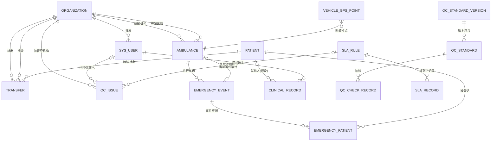

# 三大模块数据库设计表文档（基层调度 · 医院质控 · 基层医生Dr）

> 版本：V1.1 ｜ 编制日期：2026-10-13
> 设计输入：《04-前端数据流转文档-三大模块.md》（前端数据流转文档 V1.0，同目录；源文件 D:\前端数据流转文档-三大模块.md）
> 结构说明：数据字典章节组织对齐《D:\DB-TABLES.md》——按前端菜单模块（模块 1～5 + 公共基础表）→ 业务子域 → 数据表组织，文末附「核心外键关联速查」与「动态枚举字典总表」；本设计未覆盖的模块/子域以说明标注，不虚构表。
> 目标数据库：MySQL 8.x ｜ 存储引擎 InnoDB ｜ 字符集 utf8mb4 / utf8mb4_unicode_ci
> 阅读对象：后端开发工程师、DBA、系统架构师、测试工程师、技术负责人
> 编制约定：表结构以数据字典表格呈现；假设设计之处均在注释与 §6 待确认清单中显式标注。

> **V1.1 变更说明（结构重组，16 表表结构内容与 V1.0 一致）**
> 1. 原「§4 数据字典」16 张表按《DB-TABLES.md》的前端菜单模块结构重新归位：模块 1 急救调度（4 表）、模块 3 基层调度（1 表）、模块 4 医院质控（6 表）、模块 5 基层医生Dr.（1 表）、公共基础表（4 表）；模块 2 急救监控不在本设计范围（以说明标注）。
> 2. 新增「核心外键关联速查」「动态枚举字典总表」两章，内容取自 V1.0 数据字典与 ER 分析，未新增设计。
> 3. 其余章节（设计输入与范围、业务数据分析、ER 关系、设计说明与建议、待确认清单）原样保留；仅 3 处引用/指引文字随结构更新（「同 §4.4 取值」→「同 `ambulance.status` 取值」、「理由同 §4.5」→ 直接表述并指向 §5.2、枚举取值指引指向《动态枚举字典总表》）。
> 4. 按评审意见删除「建表 SQL（DDL）」章节（V1.0 §5），文档不含 DDL；原「设计说明与建议」「待确认问题清单」由 §6/§7 顺延为 §5/§6，全文引用坐标已同步更新。

---

## 1. 设计输入与范围

本文档以《前端数据流转文档-三大模块》为唯一设计依据，覆盖其中三大模块全部业务数据的落库设计；前端 localStorage 草稿/开关、纯前端计算的派生指标按 §5.3/§5.4 说明处理，不单独建表。

| 模块 | 文档中的业务数据 | 支撑表 |
| --- | --- | --- |
| 基层调度 | `dispatch-live`（事件流）、救护车台账、车辆 GPS/ETA、患者登记表单 | `emergency_event`、`ambulance`、`vehicle_gps_point`、`patient`、`emergency_patient` |
| 医院质控 | 质控标准（版本/标准项/抽检）、SLA 规则与记录、整改工单（编号/截止时间/来源/严重度/状态/机构报表） | `qc_standard_version`、`qc_standard`、`qc_check_record`、`sla_rule`、`sla_record`、`qc_issue` |
| 基层医生Dr | 医生档案、诊疗记录、视频资源（本地/B站映射） | `sys_user`、`clinical_record`、`dr_video` |
| 公共与转诊 | 机构、患者主档、转诊单（状态/确认/驳回）、登录账号 | `organization`、`patient`、`transfer`、`sys_user` |

---

## 2. 业务数据分析

### 2.1 业务数据清单（文档数据项 → 落库字段映射）

**基层调度**

| 文档数据项 | 出处（数据流转文档） | 落库位置 |
| --- | --- | --- |
| 事件 `id / task120Id / vehicleId / vehiclePlate / level / chiefComplaint / pickupAddress / destination / status / startedAt / etaHospitalMinutes / etaPatientMinutes / scorePlan / treatPlan` | §5.1 DispatchEvent | `emergency_event` 各字段 |
| 车辆 `id / plate / org / boundHospital / crew / status / currentEventId` | §5.1 Amb | `ambulance`（org/bound_hospital → `organization` 外键） |
| GPS `id / plate / status / etaMinutes / route[][]` | §5.1 Vehicle | `ambulance`（plate/status）+ `vehicle_gps_point`（route 折线 → 按时序打点） |
| 登记表单 `name / gender / age / phone` + `chiefComplaint` 等上下文 + `savedAt` | §5.1.5 PatientForm | `patient`（人）+ `emergency_patient`（登记单，registered_at=savedAt） |
| 提交存档键 `huaxi-dispatch-patient-{id}`、草稿键 | §5.1.5 / §5.4 | 提交数据由 `emergency_patient` 承接；草稿不入库（§5.4） |

**医院质控**

| 文档数据项 | 出处 | 落库位置 |
| --- | --- | --- |
| `version` | §5.2 qc-standards | `qc_standard_version.version_code` |
| `standards[{id,name,target,complianceRate}]` | §5.2 | `qc_standard` |
| `recentEvents[{at,standardId,ok,note}]` | §5.2 | `qc_check_record` |
| `rules[{id,name,limitMinutes,audience}]` | §5.2 qc-sla | `sla_rule` |
| `records[{id,kind,subject,owner,limitMinutes,usedMinutes,arrivedAt,overtime}]` | §5.2 | `sla_record` |
| 整改台账「整改编号 / 截止时间 / 来源」、报表 `severity / status(QC_OPEN) / by_org` | §5.2.3 / §5.2 qc-issues-report | `qc_issue`（报表为聚合派生，见 §5.3） |
| 前端计算的 SLA 行（`result / over / source` 等） | §5.2.2 | 派生计算，不入库（§5.3） |

**基层医生Dr**

| 文档数据项 | 出处 | 落库位置 |
| --- | --- | --- |
| 医生 `real_name / username / org.org_name / org_id / user_status` | §5.3 | `sys_user` + `organization` |
| 诊疗 `record_code / diagnosis / chief_complaint / visit_at / doctor_name` | §5.3 | `clinical_record`（doctor_name 由关联输出，不冗余） |
| 视频 `cpr/earthquake/flu → {bvid,title,topic}`、本地 `/media/{key}.mp4` | §5.3.2 | `dr_video`（现状前端硬编码，建表后可配置化） |

**公共与转诊**

| 文档数据项 | 出处 | 落库位置 |
| --- | --- | --- |
| `transfer_code / patient.name / from_org / to_org / urgency_level / transfer_status / confirm_status / updated_at` | §5.3 | `transfer` |
| confirm / reject 动作（§8-6） | §8 | `transfer.transfer_status / confirm_status / confirmed_by / confirmed_at / reject_reason` |
| 登录（JWT） | §2 技术栈 / §8-1 | `sys_user`（password 散列 + 登录审计字段） |

### 2.2 读写场景映射（前端动作 → 数据库读写）

| 前端场景（文档出处） | 读 | 写 |
| --- | --- | --- |
| 实时出警页 10s 轮询（§5.1.1） | `emergency_event` ⋈ `ambulance`（dispatch-live 聚合） | — |
| 事件选中 / hash 上下文（§5.1.1） | 同上（按 event/vehicle/task 检索） | — |
| 提交患者登记（§5.1.5） | `patient`（按手机号/姓名查重，建议） | `patient` upsert + `emergency_patient` 插入（对应 `POST /v1/dispatch/patients`，待确认 §6-2） |
| 车辆监控 5s GPS 轮询（§5.1.3） | `ambulance` + `vehicle_gps_point`（取最近点连成 route） | `vehicle_gps_point` 打点 |
| 质控标准页（§5.2.1） | `qc_standard_version` + `qc_standard` + `qc_check_record` | — |
| 环节时限页（§5.2.2） | `sla_rule` + `sla_record`（前端合并计算展示） | — |
| 质控统计/CSV 导出（§5.2.4） | `qc_issue` 聚合（total / by_severity / by_status / by_org） | — |
| 整改闭环动作（qc-issues close） | `qc_issue` | `status / closed_at / closed_by` |
| Dr 页医生/诊疗面板（§5.3.3） | `sys_user`（医生）+ `clinical_record` | — |
| Dr 视频列表（§5.3.2） | `dr_video` | — |
| 转诊列表 + 确认/驳回（§5.5 / §8-6） | `transfer` ⋈ `patient` ⋈ `organization` | `transfer_status / confirm_status / confirmed_* / reject_reason` |
| 登录（§2 / §8-1） | `sys_user`（校验 + 签发 JWT） | `last_login_at / last_login_ip` |

---

## 3. ER 关系分析

### 3.1 实体与关系结论

| 关系 | 类型 | 关联字段 | 说明 |
| --- | --- | --- | --- |
| `organization` — `sys_user` | 1:N | `sys_user.org_id` | 医生归属机构 |
| `organization` — `ambulance` | 1:N ×2 | `ambulance.org_id`（所属）、`bound_hospital_org_id`（绑定医院） | 同表两个不同语义外键 |
| `organization` — `transfer` | 1:N ×2 | `from_org_id` / `to_org_id` | 转出/接收双方 |
| `ambulance` — `emergency_event` | 1:N | `emergency_event.vehicle_id` | 一车可执行多个历史事件 |
| `ambulance` — `emergency_event` | 1:1（当前指针） | `ambulance.current_event_id` | 反范式"当前执行事件"指针，可空 |
| `emergency_event` — `emergency_patient` | 1:N | `emergency_patient.event_id` | 一次事件可多次登记（换车重登记场景） |
| `patient` — `emergency_patient` | 1:N | `emergency_patient.patient_id` | 人与登记单分离，避免同名重复建档 |
| `patient` — `transfer` / `clinical_record` | 1:N | `patient_id` | 转诊对象、就诊人 |
| `sys_user` — `clinical_record` | 1:N | `clinical_record.doctor_id` | 接诊医生 |
| `qc_standard_version` — `qc_standard` | 1:N | `qc_standard.version_id` | 版本→标准项 |
| `qc_standard` — `qc_check_record` | 1:N | `qc_check_record.standard_id` | 标准项→抽检记录 |
| `sla_rule` — `sla_record` | 1:N | `sla_record.rule_code`（逻辑外键，同 `kind`） | 规则→时效记录 |
| `sla_rule` — `qc_issue` | 1:N（可选） | `qc_issue.sla_rule_code` | 整改单关联时限环节（支撑前端"关联环节/时限标准"列） |
| `sys_user` — `qc_issue` | 1:N（可选） | `qc_issue.closed_by` | 闭环操作人 |

**多对多结论：** 三大模块业务中不存在 M:N 关系，无需中间表。`patient` 与 `ambulance` 经 `emergency_patient`（登记单）间接关联，属两个 1:N，不设 M:N 中间表。

### 3.2 ER 图

---

## 4. 数据字典通用约定

| 字段 | 类型 | 说明 |
| --- | --- | --- |
| `id` | BIGINT UNSIGNED AUTO_INCREMENT | 主键 |
| `created_at` / `updated_at` | DATETIME | 创建/更新时间，DEFAULT CURRENT_TIMESTAMP（updated_at ON UPDATE） |
| `deleted_at` | DATETIME NULL | 逻辑删除标记，仅用于需业务留痕的表：`sys_user`、`patient`、`qc_issue` |

枚举字段统一用 VARCHAR 存英文码（可扩展、与后端"英文码 + 前端映射"约定一致），全部取值在字段注释与《动态枚举字典总表》逐项列明。

---

## 模块 1 急救调度

### 1.1 急救事件

#### `emergency_event` 急救事件表

> 表注释：120 急救事件（一次出车一条；dispatch-live 事件流数据源）

| 字段名 | 类型 | 空 | 默认 | 键 | 注释 |
| --- | --- | --- | --- | --- | --- |
| id | BIGINT UNSIGNED | 否 | 自增 | PK | 主键 |
| event_code | VARCHAR(32) | 否 | — | UK | 事件编号（JSON `id`） |
| task_120_id | VARCHAR(32) | 否 | — | UK | 120 任务号（task120Id，前端跨页上下文主键） |
| vehicle_id | BIGINT UNSIGNED | 否 | — | FK | 执行车辆 → ambulance.id |
| vehicle_plate | VARCHAR(16) | 是 | NULL | — | 车牌快照（反范式冗余：事件级快照，防车辆后续换牌影响历史记录，理由见 §5.2） |
| level | VARCHAR(16) | 否 | GENERAL | IDX | 事件等级：CRITICAL-重症 / ACUTE-急症 / GENERAL-一般（假设取值，见 §6-6） |
| chief_complaint | VARCHAR(255) | 是 | NULL | — | 主诉（chiefComplaint） |
| pickup_address | VARCHAR(255) | 是 | NULL | — | 接诊地址（pickupAddress） |
| destination | VARCHAR(128) | 是 | NULL | — | 目的地（destination） |
| status | VARCHAR(16) | 否 | DISPATCHING | IDX | 事件状态：DISPATCHING / ON_SCENE / RETURNING / STANDBY（同 `ambulance.status` 取值，兼容性见 §6-1） |
| started_at | DATETIME | 是 | NULL | IDX | 出警开始时间（startedAt，SLA"出警到院"计算起点） |
| eta_hospital_minutes | INT | 是 | NULL | — | 预计到院分钟数（etaHospitalMinutes） |
| eta_patient_minutes | INT | 是 | NULL | — | 预计到达患者分钟数（etaPatientMinutes） |
| score_plan | VARCHAR(500) | 是 | NULL | — | 评分方案（scorePlan） |
| treat_plan | VARCHAR(500) | 是 | NULL | — | 救治方案（treatPlan） |
| created_at / updated_at | DATETIME | 否 | CURRENT_TIMESTAMP | — | 通用时间字段 |

### 1.2 实时出警

> 本设计不单独建实时状态/统计表：实时出警数据由 `emergency_event` ⋈ `ambulance` 聚合输出（dispatch-live），`activeCount` 为实时聚合，均属派生数据不落库（见 §5.3）。

### 1.3 远程会诊

> 三大模块数据流转未覆盖会诊业务，本设计暂无会诊表。

### 1.4 患者登记

#### `emergency_patient` 患者车上登记表

> 表注释：车上患者登记单（PatientForm 提交落库；**前端草稿仅存 localStorage，不入本表**，见 §5.4）

| 字段名 | 类型 | 空 | 默认 | 键 | 注释 |
| --- | --- | --- | --- | --- | --- |
| id | BIGINT UNSIGNED | 否 | 自增 | PK | 主键 |
| event_id | BIGINT UNSIGNED | 是 | NULL | FK | 关联事件 → emergency_event.id |
| task_120_id | VARCHAR(32) | 是 | NULL | UK | 120 任务号快照；无任务时为空（对应前端 `DRAFT-{时间戳}` 键场景；同任务重复提交按唯一键覆盖，见 §5.2） |
| vehicle_id | BIGINT UNSIGNED | 是 | NULL | FK | 登记时车辆 → ambulance.id |
| vehicle_plate | VARCHAR(16) | 是 | NULL | — | 车牌快照（反范式冗余：登记级历史快照，防车辆后续换牌影响历史记录，理由见 §5.2） |
| patient_id | BIGINT UNSIGNED | 否 | — | FK | 患者主档 → patient.id |
| chief_complaint | VARCHAR(255) | 是 | NULL | — | 主诉快照（chiefComplaint） |
| registered_at | DATETIME | 否 | CURRENT_TIMESTAMP | — | 登记时间（前端 savedAt） |
| created_at / updated_at | DATETIME | 否 | CURRENT_TIMESTAMP | — | 通用时间字段 |

### 1.5 车辆监控

#### `ambulance` 救护车表

> 表注释：救护车台账（车辆、班组、绑定医院、当前事件）

| 字段名 | 类型 | 空 | 默认 | 键 | 注释 |
| --- | --- | --- | --- | --- | --- |
| id | BIGINT UNSIGNED | 否 | 自增 | PK | 主键 |
| plate | VARCHAR(16) | 否 | — | UK | 车牌号（plate） |
| org_id | BIGINT UNSIGNED | 否 | — | FK | 所属机构 → organization.id（列表 org） |
| bound_hospital_org_id | BIGINT UNSIGNED | 是 | NULL | FK | 绑定医院 → organization.id（boundHospital） |
| crew | VARCHAR(128) | 是 | NULL | — | 随车班组（crew，文本描述） |
| status | VARCHAR(16) | 否 | STANDBY | IDX | 车辆状态：DISPATCHING-出警中 / ON_SCENE-现场处置 / RETURNING-返院途中 / STANDBY-待命（英文码约定，与前端中文匹配的兼容性见 §6-1） |
| current_event_id | BIGINT UNSIGNED | 是 | NULL | FK | 当前执行事件 → emergency_event.id（"当前指针"反范式，可空；与 emergency_event.vehicle_id 双向引用，如建物理外键需注意加约束顺序） |
| created_at / updated_at | DATETIME | 否 | CURRENT_TIMESTAMP | — | 通用时间字段 |

#### `vehicle_gps_point` 车辆GPS轨迹点表

> 表注释：车辆 GPS 轨迹打点（文档中 route 折线的落库形态：按时序打点，前端取轨迹连线；演示插值动画不落库）

| 字段名 | 类型 | 空 | 默认 | 键 | 注释 |
| --- | --- | --- | --- | --- | --- |
| id | BIGINT UNSIGNED | 否 | 自增 | PK | 主键 |
| vehicle_id | BIGINT UNSIGNED | 否 | — | FK | 车辆 → ambulance.id |
| record_time | DATETIME | 否 | — | IDX(联合) | 打点时间 |
| lng | DECIMAL(10,6) | 否 | — | — | 经度 |
| lat | DECIMAL(10,6) | 否 | — | — | 纬度 |
| eta_minutes | INT | 是 | NULL | — | 该时点预计到达分钟（etaMinutes） |
| created_at | DATETIME | 否 | CURRENT_TIMESTAMP | — | 创建时间 |

> 设计说明：route 以 `number[][]` 折线出现在文档（§5.1），为演示动画数据；真实轨迹按本表打点存储（理由与 JSON 列备选方案见 §5.2/§5.6）。写入频率≈车辆数×每 5 秒 1 点（文档轮询周期），归档策略见 §5.6。

---

## 模块 2 急救监控

> 本设计范围（三大模块：基层调度、医院质控、基层医生Dr）未覆盖急救监控域（预警通知、科室监控、床位/设备、五大中心、基层重症监护），暂无表；后续如扩展监控域，另立设计文档。

---

## 模块 3 基层调度

### 3.1 基层会诊

> 三大模块数据流转未覆盖基层会诊业务，本设计暂无会诊表。

### 3.2 医院转诊

#### `transfer` 转诊单表

> 表注释：县域上转转诊单（转诊列表 + confirm/reject 动作数据源）

| 字段名 | 类型 | 空 | 默认 | 键 | 注释 |
| --- | --- | --- | --- | --- | --- |
| id | BIGINT UNSIGNED | 否 | 自增 | PK | 主键 |
| transfer_code | VARCHAR(32) | 否 | — | UK | 转诊编号（transfer_code） |
| patient_id | BIGINT UNSIGNED | 否 | — | FK | 患者 → patient.id |
| from_org_id | BIGINT UNSIGNED | 否 | — | FK | 转出机构（下级）→ organization.id |
| to_org_id | BIGINT UNSIGNED | 否 | — | FK | 接收机构（县级）→ organization.id |
| urgency_level | VARCHAR(16) | 否 | — | — | 紧急程度（文档未穷举取值，见 §6-6） |
| transfer_status | VARCHAR(24) | 否 | TRANSFER_PENDING | IDX | 转诊状态：TRANSFER_PENDING-待接收 / CONFIRMED-已确认 / REJECTED-已驳回 / IN_TRANSIT-转运中 / COMPLETED-已完成 |
| confirm_status | VARCHAR(24) | 是 | NULL | — | 确认子状态（与 transfer_status 的语义边界见 §6-9） |
| confirmed_by | BIGINT UNSIGNED | 是 | NULL | FK | 确认/驳回操作人 → sys_user.id（设计建议字段，支撑 confirm/reject 接口，见 §6-10） |
| confirmed_at | DATETIME | 是 | NULL | — | 确认/驳回时间（设计建议字段） |
| reject_reason | VARCHAR(255) | 是 | NULL | — | 驳回原因（设计建议字段） |
| created_at / updated_at | DATETIME | 否 | CURRENT_TIMESTAMP | — | 通用时间字段 |

### 3.3 基层机构管理

> 机构与人员档案由公共基础表 `organization` / `sys_user` 承担（见《公共基础表》P.1/P.2），不重复建表。

### 3.4 基层远程监护

> 三大模块数据流转未覆盖基层远程监护业务，本设计暂无相关表。

---

## 模块 4 医院质控

### 4.1 智能监控

#### `sla_rule` SLA时限规则表

> 表注释：环节时限规则（rules[]；前端缺省阈值 10/30 分钟即来自本表语义）

| 字段名 | 类型 | 空 | 默认 | 键 | 注释 |
| --- | --- | --- | --- | --- | --- |
| id | BIGINT UNSIGNED | 否 | 自增 | PK | 主键 |
| rule_code | VARCHAR(32) | 否 | — | UK | 规则编码：SLA-ALERT-预警到床 / SLA-DISPATCH-出警到院 / 五大中心路径 / 整改工单 等（rule id/kind） |
| name | VARCHAR(64) | 否 | — | — | 规则名称（name） |
| limit_minutes | INT | 否 | — | — | 时限分钟数（limitMinutes） |
| audience | VARCHAR(64) | 是 | NULL | — | 适用对象（audience） |
| enabled | TINYINT(1) | 否 | 1 | — | 是否启用：1-是 0-否 |
| created_at / updated_at | DATETIME | 否 | CURRENT_TIMESTAMP | — | 通用时间字段 |

#### `sla_record` SLA时效记录表

> 表注释：环节时效记录（records[]；前端展示的"计算行"由本表 + 事件数据派生，见 §5.3）

| 字段名 | 类型 | 空 | 默认 | 键 | 注释 |
| --- | --- | --- | --- | --- | --- |
| id | BIGINT UNSIGNED | 否 | 自增 | PK | 主键 |
| rule_code | VARCHAR(32) | 否 | — | IDX(联合) | 规则编码（kind），逻辑关联 sla_rule.rule_code（同库弱外键，不建物理约束以便扩展 kind） |
| subject | VARCHAR(128) | 否 | — | IDX(联合) | 时效对象描述（subject；与 rule_code 组成前端去重键 kind\|subject） |
| owner | VARCHAR(64) | 是 | NULL | — | 责任人（前端展示"随车组/当班医生"等文本；是否改为关联 sys_user 见 §6-8） |
| limit_minutes | INT | 否 | — | — | 时限快照（limitMinutes，记录生成时刻的阈值快照） |
| used_minutes | INT | 是 | NULL | — | 已用时分钟（usedMinutes） |
| arrived_at | DATETIME | 是 | NULL | — | 到达时间（arrivedAt） |
| overtime | TINYINT(1) | 否 | 0 | IDX | 是否超时：1-超时 0-未超时 |
| created_at / updated_at | DATETIME | 否 | CURRENT_TIMESTAMP | — | 通用时间字段 |

### 4.2 质控统计

#### `qc_standard_version` 质控标准版本表

> 表注释：质控标准版本（qc-standards 顶层 version）

| 字段名 | 类型 | 空 | 默认 | 键 | 注释 |
| --- | --- | --- | --- | --- | --- |
| id | BIGINT UNSIGNED | 否 | 自增 | PK | 主键 |
| version_code | VARCHAR(32) | 否 | — | UK | 版本号（version） |
| published_at | DATETIME | 是 | NULL | — | 发布时间（设计建议字段） |
| remark | VARCHAR(255) | 是 | NULL | — | 备注（可承载 qc-sla 顶层 notice 公告类文本，见 §5.3） |
| created_at / updated_at | DATETIME | 否 | CURRENT_TIMESTAMP | — | 通用时间字段 |

#### `qc_standard` 质控标准项表

> 表注释：质控标准项（standards[]）

| 字段名 | 类型 | 空 | 默认 | 键 | 注释 |
| --- | --- | --- | --- | --- | --- |
| id | BIGINT UNSIGNED | 否 | 自增 | PK | 主键 |
| version_id | BIGINT UNSIGNED | 否 | — | FK | 所属版本 → qc_standard_version.id |
| standard_code | VARCHAR(32) | 否 | — | UK | 标准编码（standards[].id） |
| name | VARCHAR(128) | 否 | — | — | 标准名称（name） |
| target | VARCHAR(255) | 是 | NULL | — | 质控目标（target） |
| compliance_rate | DECIMAL(5,2) | 否 | 0 | — | 合规率，百分数 0~100（complianceRate；前端 ×100 取整展示，此处存百分数值） |
| enabled | TINYINT(1) | 否 | 1 | — | 是否启用：1-是 0-否 |
| created_at / updated_at | DATETIME | 否 | CURRENT_TIMESTAMP | — | 通用时间字段 |

#### `qc_check_record` 质控抽检记录表

> 表注释：质控抽检达标记录（recentEvents[]）

| 字段名 | 类型 | 空 | 默认 | 键 | 注释 |
| --- | --- | --- | --- | --- | --- |
| id | BIGINT UNSIGNED | 否 | 自增 | PK | 主键 |
| standard_id | BIGINT UNSIGNED | 否 | — | FK | 标准 → qc_standard.id |
| check_at | DATETIME | 否 | — | IDX(联合) | 抽检时间（at） |
| ok | TINYINT(1) | 否 | — | — | 是否达标：1-达标 0-未达标（ok，前端按此着色） |
| note | VARCHAR(255) | 是 | NULL | — | 备注（note） |
| created_at / updated_at | DATETIME | 否 | CURRENT_TIMESTAMP | — | 通用时间字段 |

#### `qc_issue` 质控问题（整改工单）表

> 表注释：质控问题与整改工单（整改台账 + 质控统计报表 + CSV 导出的数据源）

| 字段名 | 类型 | 空 | 默认 | 键 | 注释 |
| --- | --- | --- | --- | --- | --- |
| id | BIGINT UNSIGNED | 否 | 自增 | PK | 主键 |
| issue_no | VARCHAR(32) | 否 | — | UK | 整改编号（台账"整改编号"列） |
| source | VARCHAR(64) | 是 | NULL | — | 来源（台账"来源"列） |
| severity | VARCHAR(16) | 否 | MEDIUM | — | 严重程度：HIGH / MEDIUM / LOW（文档仅证实 HIGH，全量枚举见 §6-5） |
| status | VARCHAR(16) | 否 | QC_OPEN | IDX | 整改状态：QC_OPEN-待整改 / QC_CLOSED-已闭环（文档证实 QC_OPEN 与 close 接口，全量枚举见 §6-5） |
| sla_rule_code | VARCHAR(32) | 是 | NULL | FK | 关联环节 → sla_rule.rule_code（支撑前端"关联环节/时限标准"增强列的落库形态） |
| deadline | DATETIME | 是 | NULL | IDX | 整改截止时间（台账"截止时间"列） |
| supervise_org_id | BIGINT UNSIGNED | 是 | NULL | FK | 被督导机构 → organization.id |
| supervise_target | VARCHAR(128) | 是 | NULL | — | 机构名称快照（反范式：报表 by_org 直接输出、兼容机构名变更，理由见 §5.2） |
| closed_at | DATETIME | 是 | NULL | — | 闭环时间 |
| closed_by | BIGINT UNSIGNED | 是 | NULL | FK | 闭环操作人 → sys_user.id |
| deleted_at | DATETIME | 是 | NULL | — | 软删除标记 |
| created_at / updated_at | DATETIME | 否 | CURRENT_TIMESTAMP | — | 通用时间字段 |

### 4.3 质控提醒

> 提醒/订阅类功能未在三大模块数据流转中出现，本设计暂无相关表。

---

## 模块 5 基层医生 Dr.

### 5.1 视频展示

#### `dr_video` 医教视频资源表

> 表注释：Dr 模块医教视频（现状为前端硬编码映射 BILI_VIDEOS，建表后配置化，见 §6-7）

| 字段名 | 类型 | 空 | 默认 | 键 | 注释 |
| --- | --- | --- | --- | --- | --- |
| id | BIGINT UNSIGNED | 否 | 自增 | PK | 主键 |
| video_key | VARCHAR(32) | 否 | — | UK | 视频标识（cpr / earthquake / flu，对应本地路径 `/media/{video_key}.mp4`） |
| title | VARCHAR(128) | 否 | — | — | 视频标题 |
| topic | VARCHAR(64) | 是 | NULL | — | 主题（topic） |
| source_type | VARCHAR(16) | 否 | BILIBILI | — | 来源类型：LOCAL-本地文件 / BILIBILI-B站嵌入 |
| bvid | VARCHAR(32) | 是 | NULL | — | B站视频 bvid（source_type=BILIBILI 时必填，应用层校验） |
| local_path | VARCHAR(255) | 是 | NULL | — | 本地路径（source_type=LOCAL 时必填） |
| sort_order | INT | 否 | 0 | — | 播放列表排序 |
| enabled | TINYINT(1) | 否 | 1 | — | 是否上架：1-是 0-否 |
| created_at / updated_at | DATETIME | 否 | CURRENT_TIMESTAMP | — | 通用时间字段 |

> 说明：Dr 模块的医生档案与诊疗记录由公共基础表 `sys_user` / `clinical_record` 承担（见《公共基础表》P.2/P.4）。

---

## 公共基础表

### P.1 `organization` 机构表

> 表注释：县域协同机构（县级医院 / 乡镇卫生院 / 基层网点）

| 字段名 | 类型 | 空 | 默认 | 键 | 注释 |
| --- | --- | --- | --- | --- | --- |
| id | BIGINT UNSIGNED | 否 | 自增 | PK | 主键 |
| org_code | VARCHAR(32) | 否 | — | UK | 机构编码 |
| org_name | VARCHAR(128) | 否 | — | — | 机构名称（doctors.org.org_name、transfer.org_name 输出源） |
| org_type | VARCHAR(16) | 否 | COUNTY | IDX | 机构层级：COUNTY-县级 / TOWNSHIP-乡镇 / GRASSROOTS-基层（假设值，文档未穷举，见 §6-6） |
| enabled | TINYINT(1) | 否 | 1 | — | 是否启用：1-是 0-否 |
| created_at | DATETIME | 否 | CURRENT_TIMESTAMP | — | 创建时间 |
| updated_at | DATETIME | 否 | CURRENT_TIMESTAMP（更新刷新） | — | 更新时间 |

### P.2 `sys_user` 系统用户表

> 表注释：系统账号（基层医生 / 管理者），承载 JWT 登录与 Dr 模块医生档案

| 字段名 | 类型 | 空 | 默认 | 键 | 注释 |
| --- | --- | --- | --- | --- | --- |
| id | BIGINT UNSIGNED | 否 | 自增 | PK | 主键 |
| org_id | BIGINT UNSIGNED | 是 | NULL | FK | 所属机构 → organization.id |
| username | VARCHAR(64) | 否 | — | UK | 登录账号（doctors.username） |
| password | VARCHAR(255) | 否 | — | — | 密码散列（bcrypt），**禁止明文存储** |
| real_name | VARCHAR(64) | 否 | — | — | 姓名（doctors.real_name） |
| user_status | VARCHAR(16) | 否 | ACTIVE | — | 账号状态：ACTIVE-启用 / DISABLED-停用（假设值，文档未穷举，见 §6-6） |
| role_view | VARCHAR(16) | 否 | doctor | IDX | 数据权限视图：doctor-基层医生 / director-院长视角（来源：后端已落库字段，数据流转文档未直接展示） |
| last_login_at | DATETIME | 是 | NULL | — | 最近登录时间（登录审计，设计建议字段） |
| last_login_ip | VARCHAR(45) | 是 | NULL | — | 最近登录 IP（45 兼容 IPv6） |
| deleted_at | DATETIME | 是 | NULL | — | 软删除标记 |
| created_at / updated_at | DATETIME | 否 | CURRENT_TIMESTAMP | — | 通用时间字段 |

### P.3 `patient` 患者主档表

> 表注释：患者基本信息主档（登记表单的"人"维度，供登记/转诊/诊疗复用）

| 字段名 | 类型 | 空 | 默认 | 键 | 注释 |
| --- | --- | --- | --- | --- | --- |
| id | BIGINT UNSIGNED | 否 | 自增 | PK | 主键 |
| name | VARCHAR(64) | 否 | — | IDX | 姓名（表单 name） |
| gender | VARCHAR(8) | 否 | MALE | — | 性别：MALE-男 / FEMALE-女（前端表单为"男/女"，映射关系见 §6-4） |
| age | SMALLINT UNSIGNED | 是 | NULL | — | 年龄（表单 age） |
| phone | VARCHAR(128) | 是 | NULL | IDX | 联系电话（表单 phone），**建议 AES 加密存储，展示层脱敏（如 138\*\*\*\*5678）**，密文长度预留 |
| deleted_at | DATETIME | 是 | NULL | — | 软删除标记 |
| created_at / updated_at | DATETIME | 否 | CURRENT_TIMESTAMP | — | 通用时间字段 |

### P.4 `clinical_record` 诊疗记录表

> 表注释：基层医生诊疗记录（Dr 模块业务面板数据源）

| 字段名 | 类型 | 空 | 默认 | 键 | 注释 |
| --- | --- | --- | --- | --- | --- |
| id | BIGINT UNSIGNED | 否 | 自增 | PK | 主键 |
| record_code | VARCHAR(32) | 否 | — | UK | 记录编码（record_code） |
| patient_id | BIGINT UNSIGNED | 是 | NULL | FK | 就诊人 → patient.id（**假设字段**：文档接口字段未含，按业务合理性补全，见 §6-3） |
| doctor_id | BIGINT UNSIGNED | 否 | — | FK | 接诊医生 → sys_user.id |
| chief_complaint | VARCHAR(255) | 是 | NULL | — | 主诉（chief_complaint） |
| diagnosis | VARCHAR(255) | 是 | NULL | — | 诊断（diagnosis） |
| visit_at | DATETIME | 否 | — | IDX(联合) | 就诊时间（visit_at） |
| created_at / updated_at | DATETIME | 否 | CURRENT_TIMESTAMP | — | 通用时间字段 |

> 说明：文档接口输出 `doctor_name` 由 `doctor_id` 关联查询得出，**不冗余存储**（三范式，§5.2）。

---

## 核心外键关联速查

> 依据 §3.1 实体关系结论与各表外键字段汇总，供联调与建表核对。

| 外键（表.字段） | 引用目标 | 关系 | 说明 |
| --- | --- | --- | --- |
| sys_user.org_id | organization.id | N:1 | 医生归属机构 |
| ambulance.org_id | organization.id | N:1 | 所属机构 |
| ambulance.bound_hospital_org_id | organization.id | N:1 | 绑定医院 |
| ambulance.current_event_id | emergency_event.id | 1:1（可空） | "当前执行事件"指针（反范式；与 emergency_event.vehicle_id 双向引用，如建物理外键需注意加约束顺序） |
| emergency_event.vehicle_id | ambulance.id | N:1 | 执行车辆 |
| emergency_patient.event_id | emergency_event.id | N:1 | 事件登记 |
| emergency_patient.vehicle_id | ambulance.id | N:1 | 登记时车辆 |
| emergency_patient.patient_id | patient.id | N:1 | 患者主档（人与登记单分离） |
| vehicle_gps_point.vehicle_id | ambulance.id | N:1 | 轨迹打点 |
| transfer.patient_id | patient.id | N:1 | 转诊对象 |
| transfer.from_org_id | organization.id | N:1 | 转出机构（下级） |
| transfer.to_org_id | organization.id | N:1 | 接收机构（县级） |
| transfer.confirmed_by | sys_user.id | N:1（可空） | 确认/驳回操作人（设计建议字段） |
| clinical_record.patient_id | patient.id | N:1（可空） | 就诊人（假设字段，见 §6-3） |
| clinical_record.doctor_id | sys_user.id | N:1 | 接诊医生 |
| qc_standard.version_id | qc_standard_version.id | N:1 | 版本→标准项 |
| qc_check_record.standard_id | qc_standard.id | N:1 | 标准项→抽检记录 |
| sla_record.rule_code | sla_rule.rule_code | N:1（逻辑弱外键） | 同库弱外键，不建物理约束以便扩展 kind |
| qc_issue.sla_rule_code | sla_rule.rule_code | N:1（可空） | 整改单关联时限环节 |
| qc_issue.supervise_org_id | organization.id | N:1（可空） | 被督导机构 |
| qc_issue.closed_by | sys_user.id | N:1（可空） | 闭环操作人 |

---

## 动态枚举字典总表

> 本设计枚举统一为 VARCHAR 英文码（§5.1/§5.7），未采用 `dict_*` 字典表；本总表汇总全部枚举字段取值，与各表字段注释一致。若评审后偏好《DB-TABLES.md》的 TINYINT + `dict_*` 字典表风格，可作为待确认项追加讨论（新增枚举值当前无需 DDL）。

| 枚举 | 适用表.字段 | 取值 | 备注 |
| --- | --- | --- | --- |
| 状态（车辆/事件） | emergency_event.status、ambulance.status | DISPATCHING / ON_SCENE / RETURNING / STANDBY | 出警中 / 现场处置 / 返院途中 / 待命；前端中文匹配兼容性见 §6-1 |
| 事件等级 | emergency_event.level | CRITICAL / ACUTE / GENERAL | 重症 / 急症 / 一般；假设取值见 §6-6 |
| 性别 | patient.gender | MALE / FEMALE | 男 / 女；前端"男/女"映射见 §6-4 |
| 机构层级 | organization.org_type | COUNTY / TOWNSHIP / GRASSROOTS | 县级 / 乡镇 / 基层；假设值见 §6-6 |
| 账号状态 | sys_user.user_status | ACTIVE / DISABLED | 启用 / 停用；假设值见 §6-6 |
| 数据权限视图 | sys_user.role_view | doctor / director | 基层医生 / 院长视角（后端已落库字段） |
| 严重程度 | qc_issue.severity | HIGH / MEDIUM / LOW | 文档仅证实 HIGH，全量枚举见 §6-5 |
| 整改状态 | qc_issue.status | QC_OPEN / QC_CLOSED | 待整改 / 已闭环；文档证实 QC_OPEN 与 close 接口，见 §6-5 |
| 转诊状态 | transfer.transfer_status | TRANSFER_PENDING / CONFIRMED / REJECTED / IN_TRANSIT / COMPLETED | 待接收 / 已确认 / 已驳回 / 转运中 / 已完成 |
| 紧急程度 | transfer.urgency_level | 文档未穷举 | 取值待确认，见 §6-6 |
| 视频来源 | dr_video.source_type | LOCAL / BILIBILI | 本地文件 / B站嵌入（bvid 与 local_path 二选一必填，应用层校验） |
| 启用开关 | organization.enabled、qc_standard.enabled、sla_rule.enabled、dr_video.enabled | 1 / 0 | 是 / 否 |
| 布尔标记 | qc_check_record.ok、sla_record.overtime | 1 / 0 | 达标-是/未达标-否；超时-是/未超时-否 |

---

## 5. 设计说明与建议

### 5.1 命名规范

- 表名/字段名统一小写下划线；按业务域加前缀：`sys_`（系统）、`qc_`（质控标准域）、`sla_`（时限域）、`dr_`（医教）、`emergency_`（急救调度）、`vehicle_`（车辆）、`transfer`（转诊）。
- 约束命名：主键 `PRIMARY KEY`，唯一 `uk_<表简称>_<列>`，普通/联合索引 `idx_<表简称>_<列>`，外键 `fk_<表简称>_<引用>`。
- 枚举统一 VARCHAR 存英文码（与后端"英文码 + 前端映射"约定一致），含义在表注释逐项列明，新增枚举值无需改表。

### 5.2 三范式与反范式说明

- **总体满足三范式**：人与登记分离（`patient` / `emergency_patient`）、标准与版本分离、`doctor_name`/`org_name` 均由外键关联输出而非冗余存储。
- **有意保留的 3 处反范式（冗余快照），理由如下**：
  1. `emergency_event.vehicle_plate`、`emergency_patient.vehicle_plate`：事件/登记是历史事实，车辆后续换牌不应改写历史记录（文档中车牌同时充当跨页上下文键，快照可保证一致性）。
  2. `qc_issue.supervise_target`：质控报表 `by_org` 直接按机构名输出（文档字段即机构名文本），冗余快照避免报表级联 join 且兼容机构更名。
  3. `sla_record.limit_minutes`：记录生成时刻的阈值快照，规则后续调整不改变历史记录的超时判定。
- `ambulance.current_event_id` 为 1:1"当前指针"冗余，属查询优化（免查事件表即可知车辆是否空闲），以可空外键保证一致性。

### 5.3 派生数据不落库（对应文档计算类数据）

- `dispatch-live.activeCount`、实时出警页统计 → `emergency_event.status` 实时聚合。
- SLA 计算行（`result / over / source`、"预警到床/出警到院"前端合并结果）→ `sla_record` 原始记录 + `emergency_event.started_at` 等字段实时计算；`source`（scenario/dispatch-live）为前端数据来源标记，非业务属性，不入库。
- `qc-issues-report` 的 `total / by_severity / by_status / by_org`（含 `on_time_rate`）→ `qc_issue` 聚合（GROUP BY），不建报表快照表；数据量增长后再考虑物化。
- `qc-sla` 顶层 `notice`、`grassroots-demo.json`（演示步骤条）、`scenario.json`（演示状态）→ 公告/演示配置类数据，不入业务表；`notice` 可暂存 `qc_standard_version.remark` 或后续建系统配置表。
- 前端 localStorage 键（`huaxi-dispatch-register-draft` 草稿、`huaxi-api-bridge` / `huaxi-dispatch-legacy` 开关）→ 纯本地数据，不入库；提交存档键由 `emergency_patient` 承接。

### 5.4 草稿与提交的落库边界（文档 §5.1.5 的设计映射）

- **草稿（submit=false）不入库**：属未确认数据，保留在前端 localStorage 即可（文档现状即如此）。
- **提交（submit=true）落库**：`POST /v1/dispatch/patients` 建议实现为"按 `task_120_id` upsert `emergency_patient` + upsert `patient`"，与前端同任务重复提交覆盖存档的行为对齐（§8-5 待确认项）。

### 5.5 敏感数据安全建议

- `sys_user.password`：仅存 bcrypt 散列（与 Laravel 默认一致），禁止明文/可逆加密。
- `patient.phone`：静态加密存储（AES-GCM，密钥走环境变量/KMS），API 返回与页面展示统一脱敏（`138****5678`）；本字段长度 128 为密文预留。
- 患者姓名等个人信息按最小可用原则输出，列表接口建议默认脱敏、详情页按权限放行（结合 `sys_user.role_view`）。

### 5.6 性能与容量建议

- `vehicle_gps_point` 为最高写入频率表（车辆数 × 每 5 秒 1 点）：按月 RANGE 分区（`record_time`）或定时归档 N 月前数据；若确认仅演示需要折线，可降级为 ambulance 上 JSON 列（已在 §6-6 列为待确认）。
- 轮询聚合接口（dispatch-live / sla-records）建议加短 TTL 缓存（10s 级，与前端轮询周期匹配），避免高频全表扫描。
- 报表查询（by_org / on_time_rate）走 `idx_qci_status_deadline`、`idx_qci_supervise_org` 覆盖索引路径；数据量大后考虑读写分离或物化视图。
- 列表接口统一分页（与前端 `hxBackend.list` 的 `per_page` 参数对齐）。

### 5.7 扩展性建议

- 枚举字段（status/level/severity/org_type 等）均为 VARCHAR，新增枚举值不需 DDL 变更；若团队偏好强约束，可后续加 CHECK 约束或字典表。
- `dr_video.source_type` 预留 LOCAL/BILIBILI 之外的视频源扩展位。
- `sys_user.role_view` 为数据权限预留（doctor/director），后续扩展权限模型可加 `sys_role`/`sys_user_role`，当前不引入（文档未体现多角色需求）。

---

## 6. 待确认问题清单

| # | 问题 | 影响 | 建议默认（先行设计依据） |
| --- | --- | --- | --- |
| 1 | `status` 字段取值：前端中文匹配（"出警中"等）与后端英文码约定的兼容（数据流转文档 §8-4） | 影响前端着色/统计是否需要适配层；不影响表结构（VARCHAR 已兼容两种取值） | 库存英文码（DISPATCHING 等），接口层输出英文码+statusLabel |
| 2 | 患者登记是否回传后端（文档 §8-5：提交存档当前只写 localStorage） | 决定 `emergency_patient` 的写入路径是否近期启用 | 按已落库设计，`POST /v1/dispatch/patients` upsert |
| 3 | `clinical_record.patient_id` 为假设补全字段（文档接口字段未含患者关联） | 若确认无患者关联需求可去掉该列 | 保留可空外键 |
| 4 | `gender` 映射：前端表单"男/女"，库存 MALE/FEMALE | 需前后端约定转换层 | 库存英文码，前端映射 |
| 5 | `qc_issue.severity` / `status` 全量枚举（文档仅证实 HIGH、QC_OPEN 与 close 接口） | 影响报表 by_severity 维度完整性 | HIGH/MEDIUM/LOW + QC_OPEN/QC_CLOSED |
| 6 | 枚举假设值确认：`org_type`、`user_status`、`level`、`urgency_level` 文档均未穷举取值 | 取值命名统一 | 表注释中的假设值 |
| 7 | `dr_video` 现状为前端硬编码映射，是否入库管理 | 决定视频配置是否走后台维护 | 入库配置化（表已建，可不启用） |
| 8 | `sla_record.owner` 存文本还是关联 `sys_user`（前端展示"随车组/当班医生"为角色语义） | 影响责任人统计口径 | 先存文本（忠实于文档），确认后可加 `owner_user_id` |
| 9 | `transfer.confirm_status` 与 `transfer_status` 的语义边界（双状态并存于文档） | 影响状态机设计 | confirm_status 记录确认环节结果，transfer_status 记录全流程 |
| 10 | confirm/reject 接口的操作人/时间/驳回原因是否需要落库（文档 §8-6：前端尚无调用方） | 决定 `confirmed_by/confirmed_at/reject_reason` 是否保留 | 保留（设计建议字段，可空无副作用） |

---

> 本文档基于《前端数据流转文档-三大模块》V1.0 编制，未虚构文档之外的功能与数据；全部假设已在表注释与上表显式标注。V1.1 为结构重组版（数据字典按前端菜单模块划分，对齐《DB-TABLES.md》组织方式；16 表表结构未改动，文档不含 DDL）。待确认项逐条敲定后，可出 V1.2 修订版（仅调整受影响表，不动整体结构）。
